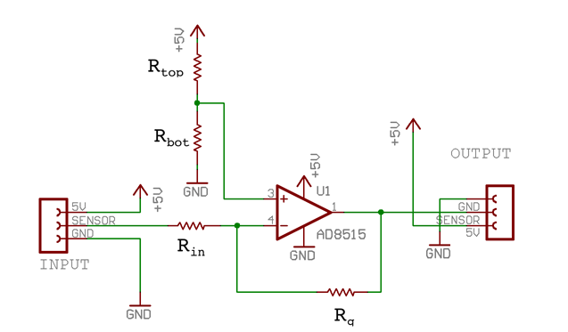

Most sensor interfaces take a range of voltages as input and convert them into a digital representation. One such interface is Electrotap’s [Teabox](http://shop.electrotap.com/products/teabox/). If you make your own sensors, or use sensors not perfectly matched to your system, you can usually improve the quality of your data by scaling your voltages into the precise range needed by your interface. In this article the focus will be on using Inverting op-amps to scale signals for use with the Teabox, but the same principles apply to most other voltage measuring applications as well. Although Inverting Op-amps are very effective and easy to use, they don’t handle high impedence signals very well (It messes up the gain). If you have a high impedence output you’ll need to use a non-inverting amplifier as described in another article [Op-Amps Part 2: Non-Inverting Op Amps and Voltage Followers](/electrotap/2005/01/11/op-amps-part-2-non-inverting-op-amps-and-voltage-followers.html).

## Signal Conditioning

The sensor inputs for the ADC (Analog to Digital Convertor) inside of the Teabox are looking for voltages between 0.25 and 4.75V. This means that if your sensors are only sending 0.0 to 1.0 V, you loose a lot of bandwidth.

> **Usable Voltage = Voltage High within range – Voltage Low within range**
> 1.0V – 0.25V = 0.75V
> **Total Voltage Range = Voltage High – Voltage Low**
> 4.5V = 4.75V – 0.25V
> **Percent of Range being used (Resolution) = Usable Voltage / Total Voltage Range**
> 16.7% = 0.75V / 4.5V
> **Voltage per bit = Total Voltage Range / # of divisions (Teabox is 12-bit, so 4096 divisions)**
> 0.001098633V = 4.5V / 4096
> **Number of divisions used = Usable Voltage / Voltage per Bit**
> 682.7 = 0.75V / 0.001098633V
>  
Therefore your sensor is only using 16.7% of the resolution available to you (or 682 steps). For some uses, this is adequate, but we didn’t go to all the trouble to put 12 bit convertors for you to only get 8 or 9 bit resolution.

To fix this problem, you need to be able to scale your data to the appropriate voltage range, and then shift it into the right range. In the example above you would scale the data from 0.0 -1.0V to 0.0 – 4.5V and then shift it to 0.25 – 4.75V.

This is a fairly straightforward procedure using a general purpose op amp, some resistors, and a little bit of soldering.

## Equipment & Supplies Required

- Op Amp
- 1 to 5% resistors of an appropriate value
- Perfboard
- Solder
- Soldering Iron
- A little Patience

All of this stuff (sans patience) can be purchased at most electronics supply stores. I personally do most of my shopping online because it is much easier to get all of the parts you need at once. Some great places to start are: All Electronics, Digi-Key, Radio Shack, Newark, Texas Instruments, Analog Devices, etc. – see the our resources page for more options.

## Choosing the Op-Amp

The first thing that must be done is to choose an appropriate op amp. Good ones can be found from Burr Brown & Texas Instruments, Maxim, and Analog Devices. Electrotap uses the Analog Devices AD8515 for most of our on-sensor signal conditioning, however it only comes in a surface mount package which may be a little too difficult to handle without the proper equipment (but with patience it is possible!). Much easier is usually a Dual Inline Package (PDIP or CDip – plastic or ceramic). These have (usually 8) pins which are spaced at 0.1 inch intervals. They can be plugged into breadboards or soldered into perfboard. I would suggest only using the breadboards for testing and not for anything even semi-permanant; too much can go wrong with them, especially shorts.

As far as the specs are concerned, you need to find one that has very low noise. This will show up in the data sheet (which you can get from the company’s website e.g.[http://www.ti.com/](http://www.ti.com/) or [http://www.analog.com/)](http://www.analog.com/)) as: Low Noise (3nV/ Square root(Hz)), High CMRR (100+dB).

Because the Teabox only provides 5V and ground for the op amp to operate, it must be able to run on those voltages. e.g. single sided. Again this can be found in the data sheet under the Power Supply/Supply Voltage minimum and maximum. It must be able to operate from 0 to 5V. Another restriction is that the output must be able to swing from rail to rail, or at least 0.25V to 4.75V. It will be under Output, and will often show up as Vss + 0.25 and Vdd – 0.25. (e.g. 0.0 + 0.25V , 5 – 0.25V) If it is any lower than this, keep looking for a better op amp.

Here are some suggested op amps, but they are not the only ones you could use by a long shot.

- [AD8515](http://www.analog.com/Analog_Root/productPage/productHome/0,2121,generic%253DAD8515%2526level4%253D%25252D1%2526Language%253DEnglish%2526level1%253D292%2526level2%253D%25252D1%2526level3%253D%25252D1,00.html) (only in a surface mount package)
- [AD8605](http://www.analog.com/Analog_Root/productPage/productHome/0,2121,generic%253DAD8605%2526level4%253D%25252D1%2526Language%253DEnglish%2526level1%253D292%2526level2%253D%25252D1%2526level3%253D%25252D1,00.html) / AD8606 / AD8608 (only in surface mount packages)
- OPA 340 (we have not tested this with this part)
- [OPA 350](http://focus.ti.com/docs/prod/folders/print/opa350.html) (available in both surface mount and DIP packages)
- Maxim also has a few parts that you could use, however, we do not recommend them.

If you want to use a surface mount part, you can order a [SurfBoard](http://www.capitaladvanced.com/products.htm) through [Digikey](http://www.digikey.com/) upon which to solder it. Many of them allow you to attach all of the surface mount resistors right on the tiny board. For a lot of different prototyping, they work very well. If you decide to use AD8515 then you should use a 33205 SurfBoard or if you choose an SOIC part such as an AD8608 you could use something like the 9162 SurfBoard.

Here’s the schematic we’ll be using. If you are building a circuit like this it is common practice to put a capacitor between power and ground, as close to the chip as possible. For this circuit a 0.1 uF ceramic capacitor should work well. It does not appear on the schematic below, but you should definitely add the cap for the best performance.

## Find the Scaling Factor

Alright, now that we have an op amp that will do what we need it to do, we have to set it to do the right thing. The first setting we need to figure out is how much to scale the input by, our gain. In our example above, We need to scale the range of 1.0V (0.0 to 1.0 V) to 4.5V (0.25 – 4.75V). To get the scaling factor just divide the Going to Voltage by the Coming From Voltage ( 4.5 / 1.0 = 4.5). e.g. we need to multiply our input by 4.5 to get it to the correct range.

**|Gain| = Output Range / (Vin.max – Vin.min)**

The actual circuit equation for the op amp circuit we are going to use is:

**Vout = (Voff – Vin) * (Rg / Rin) + Voff**

where **Voff = (Rbot / (Rtop + Rbot)) * Vref**

This looks a little intimidating at first, but once we break it down it becomes easier to digest.

First of all, Vin is your sensor input, so if your sensor sends out between 0.0 and 1.0V, that is what comes in Vin. Notice that Vin is subtracted from Voff before it is scaled, and then Voff is added again at the end? This is because we are using the op amp in an inverting configuration (it inverts the data coming in e.g. 0.0 = 1.0 and 1.0 = 0.0). Why do we do this? Because it is *much* easier to set up and will not affect how we use the data in the end.

Next, Voff is the voltage that we send into the positive input on the op amp. It is the value that sets the point around which Vin is inverted. Vref is our power voltage of 5V, and ( Rbot / Rbot + Rtop ) is a resistor divider network to scale Vref down to the appropriate voltage.

Finally, ( Rg / Rin ) sets the scaling factor (gain) that we just figured out above. It is set by the difference in the gain resistor ( Rg ) and the input resistor ( Rin ). So, our Scaling Factor of 4.5 could be any pair of resistors where Rg was 4.5 times larger than Rin. (such as Rg = 4.5k Ohms and Rin = 1k Ohm, or Rg = 369k Ohm and Rin = 82k Ohm )

How do we choose the pair of resistors? I’m glad you asked. There are two factors that determine this. The first is that there are a number of standard values that will be easy (and inexpensive) to use. These are numbers like 1, 1.2, 2.2, 3.3, 4.7, and 8.2 . There are a large number of others, but the deciding factor is whether or not you either have the part, or can get it cheap. (Another thing to factor in is that resistors are not perfect and will be classified on how close they are to the specified value. e.g within 10%, 5%, 1%, 0.5% . I prefer 1% resistors, but 5% are by far the easiest to get a hold of, and are generally adequate) So first you need to find a decent combination of resistors that will set the scaling factor appropriately. This is a hit or miss proposition. Try plugging some numbers into these equations to see what you can use.

Here are 3 versions of the equation:

4.5 * Rg / Rin
Rin = 4.5 * Rg
Rg = Rin / 4.5
 

- Try with Rg = 1.0: 4.5 * 1.0 = 4.5 therefore Rg = 1.0 and Rin = 4.5
- Now with Rg = 10: 4.5 * 10 = 45 therefore Rg =10 and Rin = 45 (notice that if you multyply both values by the same number (10) it turns out the same.)
- Rg = 12: 4.5 * 12 = 54 therefore Rg = 12 and Rin = 54
- Rg = 82: 4.5 * 82 = 369 therefore Rg = 82 and Rin = 369
- Rg = 22: 4.5 * 22 = 99 so Rin = 99

Let’s take a look at these numbers. the first set and second set are virtually identical. If you multiply both Rg and Rin by the same number the equation is the same. Therefore we could easily use 1.0 and 4.5, 2.0 and 9.0, 10 and 45, 100 and 450, etc. Unfortunately even though 1.0 is a standard value, 4.5 will be hard to come by, so this pair is out. The next set of numbers is the same way. 12 is standard, but 54 is not.

The last set shows some promise. 22 is a standard value and 99 is very close to 100, which is a standard value. Close enough in fact that this will work. It is within 1% of our target; our resistor of 1% – 5% error is that close anyway.

So now to step 2, we must figure out how large the values should be. We could have 22 & 100 Ohms, 220 & 1k Ohms, 2.2k & 10k Ohms, or even 22k and 100k Ohms, or higher. The difference between these values is how much current will run through them. There is a trade off to limiting the current or not. If you limit the current severely (with higher resistor values), the box uses less power, and there is only so much power that the box can provide. However higher resistor values can add noise to the signal (which 12 bit converters can detect).

A good rule of thumb is to keep the resistor values between 10k and 100k Ohms. Much less than that and you start drawing significant amounts of current, and much over that and you add a bit of noise.

So let’s settle on 22k and 100k Ohm resistors for our Scaling Factor.

## Setting the Reference Voltage

So now our equation can be simplified to. . .

Vout = (Voff – Vin) * ( |Gain| ) + Voff
 Vout = (Voff – Vin) * ( 4.5 ) + Voff
 

This is much easier to deal with. Now we just need to know what our offset needs to be. So, if we rearrange the equation above to solve for Voff we get.

Voff = Vin.max * ( |Gain| / ( |Gain| + 1 )
 or Voff = Vin.max * ( 4.5 / ( 4.5 + 1 )
Now we need to plug in our values:

Voff = 1.0 * ( 4.5 / 5.5)
 Voff = 0.818182 V
So our voltage divider on the positive inpute must equal 0.818182 V.

Now that we’ve found the optimum output voltage for our voltage divider network, we still have to find the value of the resistors that make it up. Here’s the equation:

0.818182 = ( Rbot / Rtop + Rbot ) * Vref
So, plug in an easy (standard) value for R1 and solve for R2 (or vise versa)

0.818182 = (10k / 10k + Rtop) * 5v
 8181.82 + 0.818182 * Rtop = 50000
0.818182 * Rtop = 41818.18
Rtop = 51111 (or approximately 51 k Ohms)
So now Rtop = 51k Ohms and Rbot = 10k Ohms. These values are reasonable for power usage purposes. If you are worried that they are too high, adding too much noise to the circuit, you could solve the equation for Rtop = 10k this gives a value of Rbot = 1.95k Ohms.

## Simplified “Plug In The Values” Version

Vout = (Voff - Vin) * (Rg / Rin) + Voff
where Voff = (Rbot / (Rtop + Rbot)) * Vref

- Find the Gain:

**|Gain| = Output Range / (Vin.max – Vin.min) **

- Plug the gain in, pick a value for Rg and find Rin (try 10k first):

**Gain = Rg / Rin **

- Plug the gain and the max Voltage input in and find the offset value:

**Voff = Vin.max * ( |Gain| / ( |Gain| + 1 )) **

- Plug the offset and Vref (usually 5v) in, pick a value for Rtop (try 10k) and find Rbot:

**Voff = Rbot / (Rtop + Rbot) * Vref **

- Build the circuit!
Enjoy the extended range and expression of your sensors!