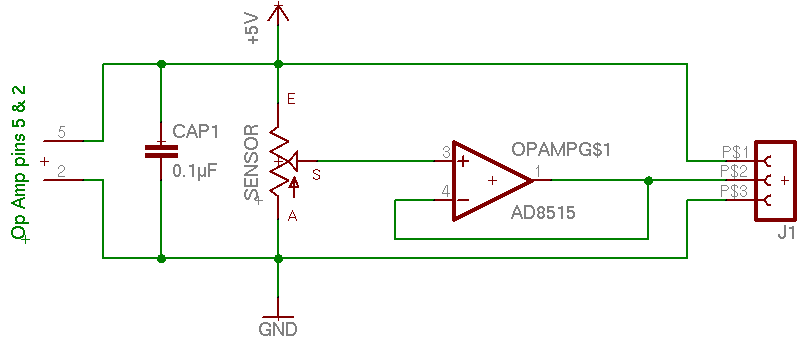

Most sensor interfaces take a range of voltages as input, and convert them into a digital representation. One such interface is the [Teabox](http://shop.electrotap.com/products/teabox). If you make your own sensors, or use sensors not perfectly matched to your system, you can usually improve the quality of your data by scaling the voltages into the precise range needed by your interface. In this article the focus will be on using non-inverting op-amps to scale signals for use with the Teabox, but the same principles apply to most other voltage measuring applications as well. Although inverting op-amps are very effective and easy to use, they don’t handle high impedance signals very well (It messes up the gain). If you have a high impedance output you’ll need to use a non-inverting amplifier.Some sensors send out high impedance signals (roughly meaning that they already have a large resistance on the signal already). This can cause problems with the gain of inverting op-amp designs and severely limit the cable distance a signal can run. Also, some sensors output a signal that doesn’t take up the full range of that the interface can handle. Just one example is Sharp’s line of Infra-Red proximity sensors which send out a high-impedance signal that runs from around 0.7V to 2.8V. No where near the 0.25-4.75V range of the Teabox (or 0-5V range of many other interfaces). A little signal conditioning can improve the data by quite a bit!

There are three generic ways to use a non-inverting amplifier circuit, each of which adds to the functionality by adding a little bit of complexity. All three have the feature of buffering a high impedance input, which is needed to guarantee accurate sensor data. In this article we will concentrate on the first and simplest variety.

The **voltage follower** is an extremely simple circuit that simply outputs a low impedance voltage that is identical to the input. This would be fairly useless, except that it changes high impedance inputs to low impedance, and makes the signal stronger. Used in conjunction with an inverting op amp, it can be a simple way to condition your signals.

## Voltage Follower

The voltage follower does just that, it follows the voltage that is sent in. Having the ability to buffer a high impedance signal can make this a useful little circuit. You can use this to give more power to a long sensor cable run, lower impedance, and protect circuitry from being overloaded.

The basic premise is this: hook up power and ground to your single-sided op amp (making sure to bypass (connect) the two with a 0.1µF capacitor to smooth out power fluctuations), run a signal into the positive input, and feed the output back into the negative input. Basically an op amp outputs whatever it can to make the positive and negative inputs cancel each other out. Because you fed the output directly back to the negative (inverting) input, it sends out the exact same thing that came in.

## Voltage Follower Schematic

This schematic shows an op-amp (the AD8515 from Analog Devices) wired up as a Voltage Follower. The Sensor is essentially a potentiometer with the outer leads connected to power and ground and the inner tap running into the positive input of the op-amp. You could easily substitute a voltage divider or many other sensors here. The op-amp’s output from pin 1 is connected directly back into the negative input to set it to voltage follower mode, as well as heading out to the Teabox through the center pin on J1 (either a cable or a three pin header). Notice that pins 5 and 2 of the op-amp (somewhat disembodied at the far left of the circuit) are connected to power and ground and are bypassed with the 0.1µF Cap. This is very important as it smooths out fluctuations in the power supply.

One final note is that the 5V and Ground indicators are not necessarily from a second power source. Most likely this entire circuit will get its power from Pin 1 on J1 (the cable or header), and ground from Pin 3, which means you can ignore the 5V/Gnd connections. If you do need to power the device externally (for instance if you are using a few sensors that need a lot of power (like the Sharp IR sensors), you must be careful to have a very clean power supply. The way sensor analog to digital converters work is that they compare the sensor input to a reference voltage. If the power supply is fluctuating, it can’t compare accurately and you will end up with noisy data. We have a Power Injector and [Powered Expander](http://shop.electrotap.com/products/expander) that can be used to add 500mA of power to an interface, although you can make one on your own using a wall wart and a decent voltage regulator: something like the LT1763 from Linear Technology.

## Equipment & Supplies Required

- Op Amp
- 1 to 5% resistors of an appropriate value
- Perfboard
- Solder
- Soldering Iron
- A little Patience

Instead of describing this all again please reference [Part 1 of the op-amp articles: Scaling Sensor Data](/electrotap/2004/11/01/op-amps-part-1-scaling-sensor-voltages.html) for a thorough discussion.

Alternatively you could do this with a surface mount part and a surfboard for a reasonably small alternative.

Once you get the circuit built, you will have a low-impedance output with plenty of power to send the signal down longer cable runs. I’ve had good luck with runs up to 50ft and have gone 100ft and more in some instances.

## Scaling?

Now that you have your impedance buffer, you may want to be able to scale the data. One of the simplest ways of doing this is to pair the Voltage Follower described above with an Inverting Op-Amp Scaler described in Part 1 [Scaling Sensor Data](/electrotap/2004/11/01/op-amps-part-1-scaling-sensor-voltages.html). Simply buffer the data first, then scale it. You can even purchase a dual op-amp (like the AD8606 among many) and do both the buffering and scale/shifting with the same part. If you are wondering why you can’t just use the Inverting Op-Amp Scaler to buffer as well, you can as long as the sensor output is low impedance. A high impedance input from the sensor will mess up the gain, hence the need for the Voltage Follower beforehand.

These two simple circuits can handle most of your signal conditioning needs. However you can set up the Non-inverting Op-Amp to scale and shift as well with a few choice resistors. When I get a chance I’ll write up Part 3 which will describe how this can be done.

Enjoy the extended range and expression of your sensors!