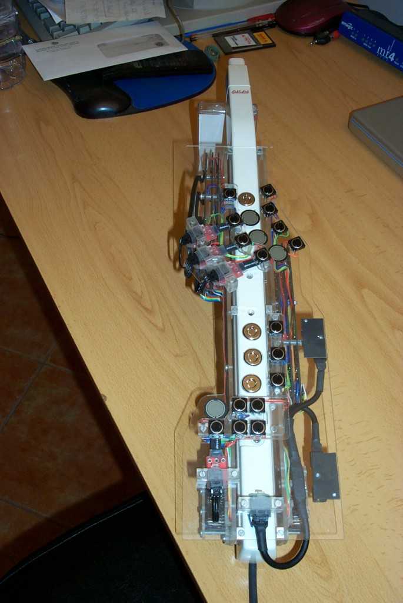
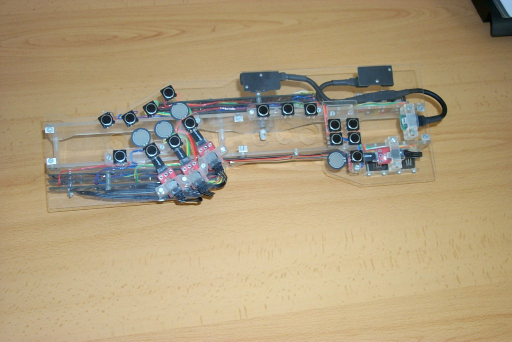
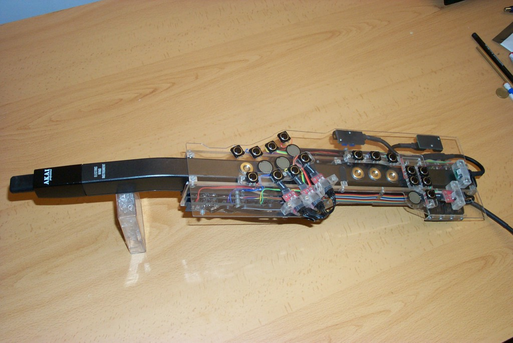

> This is a guest article about an application of the Teabox to create a stunningly beautiful extended wind controller. The Concept and Design is by Tomas Henriques and the Hardware Development is by Vitorino Henriques. — The Editor

The META-EWI is a modified EWI (Akai’s Electric Wind Instrument) to which was added a whole new set of controllers based on sensor technologies, specifically eight continuous controllers and 16 digital switches. These clearly succeed at stretching the expressiveness and the range of musical gestures found on the original instrument allowing the musician to have a more complete and far reaching control of a great variety of meaningful musical parameters.

The META-EWI keeps all of the original EWI’s sensors. These include the breath pressure sensor, commonly called breath control, which triggers the sound of each note (by enabling a VCA and a VCF that respectively control the volume and the brightness of the sound); touch (capacitance) sensors for the fingering/key system and other capacitance and resistance sensors that generate pitch bend, portamento and vibrato.

All of these sensors in the EWI simply produce varying voltages that are routed to a monophonic analog synthesizer module (EWI3000m or EWI3020m) that in turn interprets them and creates sound according to those voltages.

## Primary Modification

The first modification done on the EWI consisted in rewiring some of its guts in order to turn its Boehm (sax like) fingering into a simpler, horn like, three-valve keying system. This essential alteration not only allows me to play the EWI because I play brass type wind controllers but also and very importantly, it strips off most of the original keys thus allowing all the extra sensors to nicely fit on top of the body of the EWI.

## Extension-Controller

Actually the set of extra sensors and switches that make up the META-EWI are built on a single structure that sits on top of the instrument and therefore can also be detached from it! This was done with the goal of being able to use that structure, which I call the Extension-Controller, separately as an autonomous Controller with its 8 continuous controllers and 16 switches.

## The Extra Sensors

The META-EWI has the following extra sensors and actuators:

- 4 Force Resistance Sensors (4 CC)
- 1 Accelerometer with Tilt detection (providing 2 CC)
- 1 Joystick (providing 2 CC)
- 16 On/Off tactile switch buttons

The four force resistance sensors (FRS) are the equivalent of after-touch keys on an electronic keyboard. Each of them can be independently controlled (as polyphonic after-touch on a keyboard) and can have totally unrelated values within a given range. These 4FRS sensors are conveniently placed so that the free fingers of the musician can naturally and effortlessly access them.

The accelerometer sensor is placed at the very end of the instrument. It allows the tracking of motion in the vertical plane as well as measuring tilt. This sensor offers two continuous controllers and is an important controller since it can accurately translate the musician’s body motions which are an important and natural part of a music performance.

The joystick is placed under the instrument and it is controlled by the right hand’s thumb, the same finger that has to always touch the EWI’s earth plate to make the instrument play properly. The joystick outputs information in two separate axis, the X and Y planes thus adding two continuous controllers that also can be routed to any parameter one desires.

The sixteen on/off tactile switch buttons are placed by the after-touch (FRS) and by the touch sensitive keys, being easily accessible by the fingers of both hands. Their function can be fully programmable and changed in real time making them very useful.

All of the extra sensors and actuators output small voltages within the range of 0-5 Volt and are connected to Electrotap’s sensor interface, the Teabox. This interface feeds the sensor’s information to a personal computer via an audio cable using the S/PDIF digital format. The digitization of the sensor’s information transmitted by the interface to the computer is then interpreted by a host software program, the Max/MSP programming language.

## Modes of Use

The META-EWI is a very versatile controller whose capabilities are being expanded since they are software dependent. In its regular configuration the META-EWI can be used in five main modes:

- Sample trigger mode
- Record/playback mode
- Harmonic mode
- Synthesis mode
- Mix mode

In **Sample trigger mode** the 16 buttons are used to trigger sounds. With special button assignments at least 48 samples can be simultaneously available.

In **Record/playback mode** the 16 buttons can be used to record a musical phrase, play it back, pause it, loop it, delay it, transpose it, etc, etc. A large number of recordings can be done and stored. The buttons can also be used to quickly switch/reassign new functions for the FRS, joystick and accelerometer!

In **Harmonic mode** the combination of the 8 CC and the 16 buttons allows the creation of many different chord types with varying textures and registers. This is one of the most relevant innovations of the META-EWI since it allows a musician to harmonically accompany him/herself while playing or improvising a melody with great versatility.

In **Synthesis mode** the extra sensors and switches as well as the original sensors of theEWI are used to control synthesis parameters in software synthesis programs. In this mode the sensor information from the original instrument is sent to the computer via the MIDI out port of the EWI’s companion synthesizer module.

Finally, in **Mix mode**, any of the four previous modes can be combined.

## Conclusion

The novelty of the META-EWI consists in creating an instrument that has a high number of sensors capable of sending continuous and reliable control information in real time, while easily being able to reassign any of the sensors’ information to any parameter imaginable in real time as well. These extra capabilities turn the already versatile expressiveness of the original EWI into a more powerful instrument that enables the performer to have a wider control of the sound that he/she creates as well as being able to generate more complex musical structures that go far beyond simple monophonic playing.

The Meta-EWI extension controller and the scientific paper that explains its workings was selected for the ARTECH 2005 International Conference that took place in Portugal in August of 2005.

> Tomas Henriques was born in Vila Franca de Xira, Portugal in 1963. He studied trombone, piano and composition at the Conservatory of Music at Lisbon from 1977 till 1987 when he obtained his diploma in Composition. At the Conservatory of Lisbon he studied with composers Constanca Capdeville and Jorge Peixinho.
> His continued interest in new technologies applied to music led him to Paris where he studied at G.R.M. (Groupe de Recherches Musicales) with Philipe Mion in 1988. He later went to the United States where he got a Masters and a Ph.D. at the University at Buffalo in New York. His main professors in Buffalo were Charles Wuorinen and L.Hiller. The pieces Sibila I (1990) for piano and live electronics and Sudeste (1992) for 5 percussionists are two important works from this period which exhibit a language rooted in serial procedures.
> His compositions have been commissioned by institutions such as the Gulbenkian Foundation, Unkown Winds (2004) for piano quintet, Frames (1997) for 14 soloists, the Portuguese Ministry of Culture, Circle (2000) for solo flute, the Jorge Peixinho Electronic Music Studio, Trois R?ves (2002) for tape music, the Musica Viva Electronic Music Festival, Turning Points (2003) for string quartet and electronics, etc.
> He has presented papers on computer music subjects at the Third Practice Electronic Music Festival in Richmond-Virginia, USA, in 2004 and 2002, at the SEAMUS (Society of Electroacoustic Music of the United States) in Denton-Texas, USA in 2000 and at the ICMC(International Computer Music Conference) in San Jose-California, USA in 1992.
> He maintains a busy schedule as a lecturer on both electronic music and contemporary music and as a researcher he has developed music software for sound spatialization and for new MIDIinterface controllers.
> His compositions have been played in Music Festivals such as the North American New Music Festival, the June in Buffalo Contemporary Music Festival, the Musica Viva Festival, the Festival Synth?se, the Logos Festival, the Art Series Now festival, etc, and in several concerts in USA, England, France, Hungary, Italy and Spain.
> His music has been recorded by the Numerica and MisoRecords labels.
> Presently he is a Professor of Composition and Theory at the Faculty of Social and Human Sciences at the New University at Lisbon. At this university he also belongs to CESEM (Center for Studies in Aesthetics and Sociology of Music), a research group where he is developing a project on virtual room acoustics and also research on sensor technologies applied to music performance.