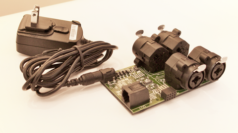

The Powered Expander is now available at [http://shop.electrotap.com/products/expander](http://shop.electrotap.com/products/expander). This is a version of the Teabox Expander that comes with an additional power supply to provide additional juice to sensors that consume a lot of power.

We’ve actually had these for quite a while, but they have not been available through our website until now. This is essential for using the Teabox with lots of IR distance sensors and other related sensors. It is quite convenient for a lot of other applications though, and we can even offer customized scaling built right into the expander for you.