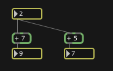

The Max API makes it easy to pass a handful of standard data types in Max: ints, floats, symbols, lists of the aforementioned.  But what happens when you want to pass a frog from one object to the next?  A frog is not a standard data type.  Instead it is something made up that we want to send hopping through our Max patch from one green object box to the next.

## Where do we start?

Before we can pass the frog from one object to another, we first need to define the frog type.  What is it?  Is it an object (meaning a proper Max class with a t_object as it’s first member)?  Or is it a naked struct or C++ class?  Or something else entirely?  Are we passing the data by value, or by reference (meaning a pointer)?

That last question may be more difficult that it seems at first glance.  Answering the question may help to determine the answer to the other questions.  If we pass by value then we have a certain amount of simplicity, but for anything other than rudimentary types it quickly becomes a very computational expensive situation.  So the obvious answer here is to pass by pointer, right?  Not so fast…  Consider the following patcher topology:

If we pass by value from the first number object, then we get the results that are shown.  If we simply pass a pointer to the value (pass by reference) without some sort of management in place then we will get very different results.  The result could be the following:

- The address of the data (2) is passed to the [+ 5] object.
- 5 is added to 2, the data now has a value of 7 and this new value is passed to the lower-right number box.
- The address of the data (which now has the value 7!) is now passed to the [+ 7] object.
- 7 is added to 7, the data now has a value of 14(!) and this new value is passed to the lower-left number box.

Indeed.  A subtle problem with real life consequences.  In our example the problem may seem trivial, but when you are operating on more complex structures (e.g. [Jitter](http://www.cycling74.com/products/jitter) or [FTM](http://ftm.ircam.fr/)) then there needs to be a system in place that allows for the graph to bifurcate without downstream operations corrupting the output of other operations happening ‘in parallel’.

## Series Overview

This introduction to the problem is the first of a multi-part series. Over the next several weeks I will be writing about several different approaches to passing custom data types in Max, and I’ll be using some real-world examples to demonstrate how and why these various strategies are effective.

- [Introduction](//web.archive.org/web/20131215235006/http://blog.74objects.com/2009/03/25/custom-data-types-1/)
- [Creating “nobox” classes](//web.archive.org/web/20131215235006/http://blog.74objects.com/2009/03/31/custom-data-types-2/)
- [Binding to symbols](//web.archive.org/web/20131215235006/http://blog.74objects.com/2009/04/07/custom-data-types-3/) (e.g. table, buffer~, coll, etc.)
- [Passing objects directly](/web/20131215235006/http://74objects.com/2010/02/06/custom-data-types-4) (e.g. Jamoma Multicore)
- Hash-based reference system (similar to Jitter)
