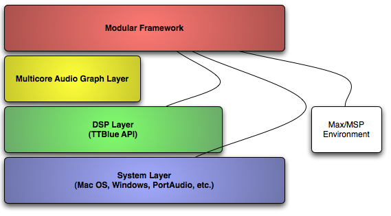
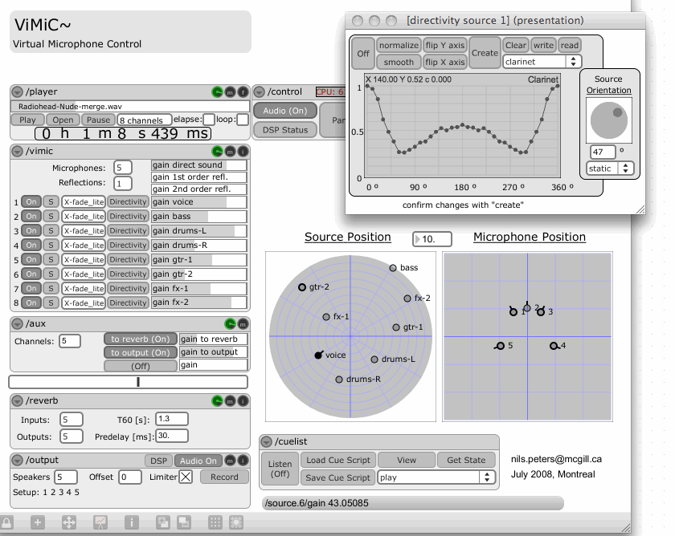

In the series [Custom Data-Types in Max](//web.archive.org/web/20130809114016/http://blog.74objects.com/2009/03/25/custom-data-types-1/) there is frequent reference to [Jamoma](http://jamoma.org/).  Jamoma is “A Platform for Interactive Art-based Research and Performance”.  Sounds great, right?  But what does it mean by “A Platform”?  How is  it structured?  What are the design considerations behind Jamoma’s architecture?  Many people are aware of some of Jamoma’s history or what it was in the past, but it has come a long way in the last couple of years.

## The Jamoma Platform

The Jamoma Platform comprises a group of projects addressing the needs of composers, performers, artists, and researchers.  These projects are orchestrated in a number of layers with each layer dependent on the layers below it, but the layers below not dependent upon the layers above them.

The modular framework is built on top of the Max environment while others are completely independent of Max.  For example, the Jamoma DSP layer is actually used to write objects for Pd and SuperCollider, plug-ins in the VST and AU formats, C++ applications in addition to creating objects for Max or user by the Jamoma Modular Framework.

The modular layer also bypasses some intermediary layers, which is indicated in this graphic with the lines that directly connect the layers.

Let’s take a look at each of these layers (bypassing the System Layer).

## Jamoma DSP Layer

At the bottom of the stack is the Jamoma DSP Layer, also known as TTBlue for historical reasons.  The DSP layer, logically enough, is where all signal processing code for Jamoma is written in C++.  There is a library of processing blocks and utilities from which to draw.  The library is extensible and can load third-party extensions to the system dynamically or at start-up.  Finally, the DSP Layer is more than just a bunch of DSP processing blocks: it includes an entire reflective OO environment in which to create the processing blocks and send them messages.

All by itself the Jamoma DSP Library doesn’t actually do anything, because it is completely agnostic about the target environment.  The Jamoma DSP repository includes example projects that can wrap or use the DSP library in Max/MSP, Pd, SuperCollider, VST and AU plug-ins, etc.  In some cases there are class wrappers that will do this in one line of code.  In all of these examples, the DSP library is used, but no other part of Jamoma is required, nor will it ever be required, as we keep a clear and firm firewall between the different layers.

## Jamoma Multicore Layer

Jamoma Multicore, hereafter we’ll simply say ‘Multicore’, is built on top of the DSP layer.  Multicore creates and manages graphs of Jamoma DSP objects to produce signal processing chains.  One can visualize this as an MSP patcher with lots of boxes connected to each other, patchcords fanning and combining, generator objects feeding processing objects etc.  Multicore does not, however, provide any user interface or visual representation; it creates the signal processing graph in memory and performs the actual operations ‘under-the-hood’.

At this time I would describe the status of the Multicore layer as “pre-alpha” – meaning it is not very stable and is in need of further research and development to fulfill its vision.

## Jamoma Modular

When most people say Jamoma, they typically are referring to the Jamoma Modular Layer, and more specifically the Jamoma Modular Framework.  The Modular framework provides a structured context for fully leveraging the power of the Max/MSP environment.  The modular layer consists of both the *modular framewor*k and a set of *components* (external objects and abstractions).  The components  are useful both with and without the modular framework.

To exemplify the *Modular Components*, we can consider the **jcom.dataspace** external.  This is an object that converts between different units of representation for a given number (e.g. decibels, linear gain, midi gain, etc.).  This is a useful component in Max/MSP regardless of whether the modular framework is being used for patcher construction or management.

The *Modular Framework*, on the other hand, is system of objects and conventions for structuring the interface of a Max patcher – both the user interface and the messaging interface.

The screenshot above (from [Spatial sound rendering in Max/MSP with ViMiC](http://www.music.mcgill.ca/%7Enils/papers/ICMC08-VIMIC_final.pdf) by N. Peters, T. Matthews, J. Braasch & S. McAdams) demonstrates the Jamoma framework in action.  There a number of modules connected together in a graph to render virtual microphone placements in a virtual space.  The module labeled ‘/cuelist’ communicates remotely with the other modules to automate their behavior.

## Digging Deeper

In future articles I’ll be treating the architecture of each of these layers in more detail.  I also will be demoing Jamoma at the [Expo ’74 Science Fair](http://expo74.net/) next week.  If you are going to be at Expo ’74, be sure to stop by and say hello.
