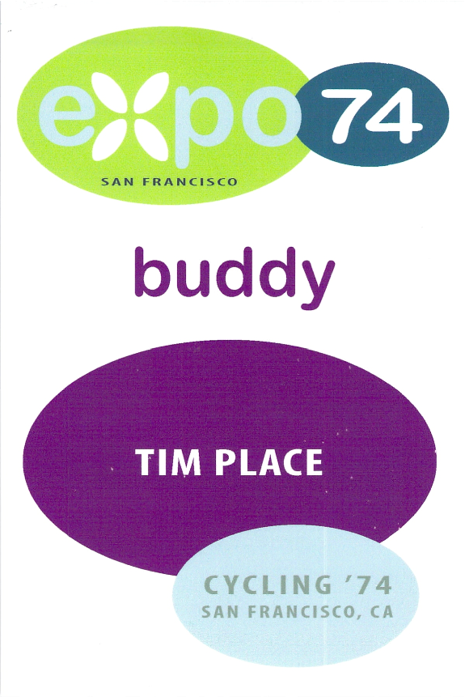
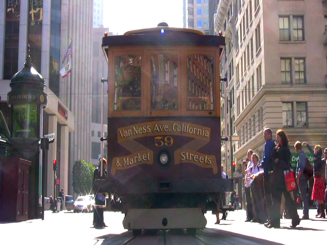
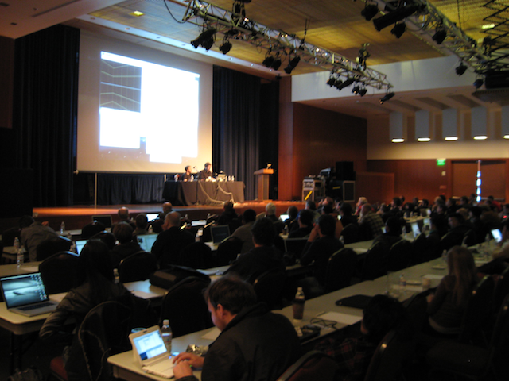
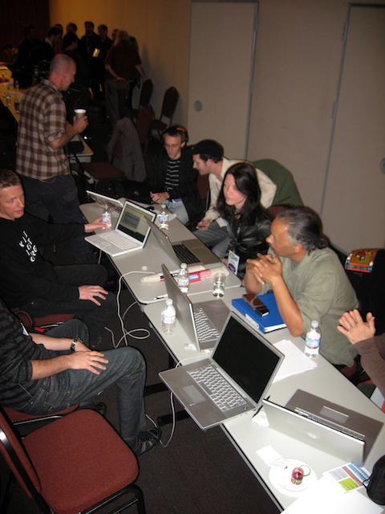

Last week I was a participant in [Expo ’74](http://expo74.net/), [Cycling ’74](http://cycling74.com/)‘s first Max user conference.  It was 120 Max-heads totally stoked-up about each other’s work and the work we’ve been doing at Cycling ’74 over the last while.  Unlike the academic conferences or trade shows to which I’m more accustomed, the attendees at Expo ’74 were exuding profound amounts of happiness.  It is really rare to experience the amount of joy and community that I saw this past week.

There are a number of topics from the Expo that I’d like to discuss in more length than I will do right now.  For the moment, I’ll give an overview and some highlights.

First, though, I will start with an admission.  I left for San Francisco with some doubts about the premise of Expo ’74.  The idea that a conference would be organized around a tool, rather than organized around a problem or research area, seemed problematic.  It ended up being quite the opposite.  I found that by all of the participants sharing a common platform that people were able to discuss the actual essence of their research, development, artistic practice, etc. without the distraction of having to preface everything with information about the technology.  Other participants understood the technology and tools, so they could fade away and allow for a clearer focus on the real artistic issues.

## Day One

Lots of things were happening on day one.  The morning included some well done presentations by my Cycling ’74 colleagues Manuel Poletti and [Darwin Grosse](http://darwingrosse.com/).  They did a nice job with Max 5 and Max for Live.  As someone already quite well acquainted their work, I was more interested by the afternoon where the presentations were about work with which I was less familiar.

[Pamela Z](http://www.pamelaz.com/) gave a history of her work with Max and showed the real practical aspects of how her performance system (not just Max) is structured.  This was capped off with a performance of Broom, which was both effective and inspiring too.  [Robert Henke](http://monolake.de/) (of Ableton fame), showed a number of his Max patchers, many of them the search for the perfect step sequencer.  He also showed some Max patches that he uses for image processing to produce album covers (I will talk about this topic more on another day).  Finally, [Barney Haynes](http://www.cycling74.com/story/2005/9/28/114113/805) showed us some documentation of his work.  There wasn’t any significant discussion of the role that Max played — and this is one of the things that made the conference really nice.  Because Max was assumed, it didn’t have to be discussed and there was no pressure to discuss it (or to hide it for that matter).

In the afternoon we split into groups named after Max objects.  My group was the Buddy group (as signified on the scan of badge).  In this first of two meetings we were to “collect data” from an excursion in the city.  Our group’s excursion consisted of a cable car ride and a visit to the [San Francisco Cable Car Museum](http://www.cablecarmuseum.org/).  The data we collected was pretty impressive.  We had 4 video camera with time information embedded, we had a couple of people with professional portable audio recording gear, we had GPS and heart-rate-monitor data logged for the entire trip, and [Joshua Goldberg](http://www.goldbergs.com/) (a fellow ‘buddy’) had his iPhone transmitting accelerometer data to his computer which logged the time-tagged accelerometer data into a coll object in Max (and yes, he carried his computer around open and running through for the whole experience).

## Day Two

Days two and three split the morning into two tracks, so it is impossible to give an overview of everything that happened.  I happened to see presentations that included [Gregory Taylor](http://rtqe.net/) (discussing how he generates control data and, more importantly, why he does it that way), [Andrew Pask](http://kaleidacousticon.com/) (discussing time management in Max), and [Andrew Benson](http://pixlpa.com/) giving an incredible introduction to writing OpenGL Shaders.  Gregory’s presentation has inspired me to start on some new work that includes some new chaotic generators for Jamoma and Andrew Benson’s presentation has got me writing shaders now, making this the session with the most immediate impact on what I’m doing.

In the afternoon there were presentations including [Brad Garton](http://www.music.columbia.edu/~brad/) showing the rtcmix object and a panel session on education.  I’ll talk more about the education panel in another post.  Brad’s talk was interesting, as I have long been a proponent of mixing graphical and text-based approaches in Max to leverage the strengths of each.  I feel pretty strongly that advocating graphical or text interfaces (all the way back to my work on Jade in 2001) for every purpose really puts you at a disadvantage because sometimes you end up with an inferior tool for a given task.

## Day Three

I bounced between rooms in the morning to cover some advanced Max external developer topics and to see [Luke Dubois](http://www.lukedubois.com/) present his work with Max.  Luke’s presentation was really well done and one of the highlights of the entire Expo for me.  I was familiar with a number of things Luke has done, and I’ve admired them before, but seeing a larger body of work together really brought it together for me in a new way.  It’s *really* impressive.  I was also nothing sort of stunned when at the end he gave away all of his Max patches.

We had an open mic session to solicit feature requests.  I had reservations about this, but no one threw any fruit at us and it seemed like we had an answer for about half of the feature requests that went like “good idea; it’s already done and will be released soon”.  There was something really funny about Robert Henke coming up to the mic and humbly submitting his feature requests for Max with everyone else.  I think it was a very democratizing experience.

The second meeting our ‘buddy’ group in the afternoon was provided so that we could take all of the data we had collected to create 5 minute performance/work for the rest of the Expo attendees (their groups had the same challenge).  We used a rope to physically connect the group as we moved through the space with out computers to provide a spatially shifting audio and visual performance.  I’m not convinced that our patches actually work though.  We only had 74 minutes to put it together, so given that constraint I think we did okay.

The conference ended on what may be the climax for me.  After the group projects we made our way up to Berkeley for a a barbeque and performance at [CNMAT](http://cnmat.berkeley.edu/).  [Bob Ostertag](http://bobostertag.com/) and Pierre Hébert put on a stunning show as a part of their [Living Cinema](http://bobostertag.com/music-liveprojects-livingcinema.htm) collaboration.  The performance featured hand drawing created and then animated in real time.  The hand drawings had a visceral and organic feel to them.  The morphological qualities of these figures was explored through gestural sequences that changes the context of the figures, the meaning of the figures, and the meanings of how the figures related to each other.  Gestural energy and and visual articulation was beautifully at one with the sonic material.

On many levels this is one of the best, if not *the* best, real-time audiovisual performance collaboration I have ever experienced.  What great way to end the Expo ’74 event.  And I didn’t even mention the food, the wine, the sushi…  it was all extraordinary.  I hope there are more of these events in the future!
