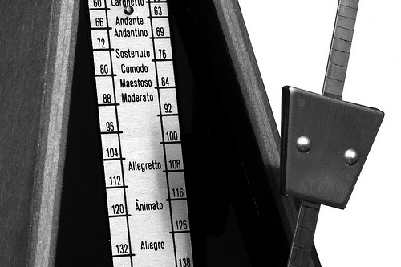
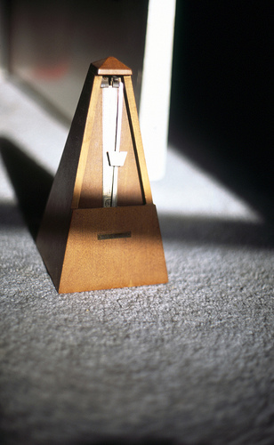

Metronome 3. Photo: Nigel Appleton.

Last night I attended a concert of György Ligeti’s music hosted by [newEar](http://newear.org/) in Kansas City.  It was spectacular.  I don’t think [the review in the Kansas City Star](http://www.kansascity.com/entertainment/music/story/1175835.html) really did it justice.

Where the review was spot-on is in saying the the most conceptually interesting piece was the *Poème Symphonique* for 100 metronomes.  During the intermission all of the metronomes were wound and then released as the audience came back into the performance space.

The metronomes looked dapper for the performance – they were rented and all were of the same make and model.  This may seem trivial, but it really did add visually to the performance, and I think sonically as well.

I doubt this work could be effective in a recording.  For one thing, the spatial information (and how the metronomes interact with the space) provides a rich amount of information when hearing the piece live.  There is also a lot of visual information.  When looking at a particular group of metronomes, it became possible to really focus and hear what was happening within that group of metronomes as a foreground element, while the rest of the ‘metronome orchestra’ laid the backdrop.  In fact, the *Cello Concerto* functioned in much the same way — a piece that never felt compelling to me from recordings and was arresting to see and hear performed live because some much of the information in the performance is transmitted visually.

I was also pleasant surprised by the spectral diversity of the performance of *Poème Symphonique*. The clicks from the metronomes in the space produces a lot of phasing, and thus difference and summation tones were audible.

Metronome. Photo: abbyladybug.

The form of the piece was a bit like the form of a big rain storm.  Slowly it winds down as the metronomes slow and stop and various beating and phasing of the metronome beats maintain an organic unity/variety.  Eventually, down to just a few metronomes, really interesting rhythmic counterpoint emerges — again, much like dripping water in metal gutters after a big rain storm.  The rhythms here also strongly mirrored the polyrhythmic “Fanfares” from the *Études pour Piano* that closed the first half (and whose performance by Robert Pherigo was also mesmerizing).  The review in the Star complained about the one rogue metronome that kept playing for 7 minutes after the others had all wound down.  In fact, I thought it was quite an interesting way to end: that one dripping eave or gutter that just keeps going.

The ticking of the last metronome also transported me back to being a kid being kept away by a very large clock at night when we visited my grandparents.  So the passing of time, being performed by a device for marking time, was serving as an *idée fixe* of sorts for a variety of imagery brought to the performance by the individual audience members, and also provided a built-in moment in the piece for reflection.  Perhaps the author of the review in the Star didn’t have much to reflect upon.

Speaking with [David McIntire](http://www.mcintiremusic.com/) afterwards, he relayed that there was a metronome in Thursday night’s rehearsal that went on for a long time at the end, so they specifically didn’t wind that one fully.  But in last night’s performance a different metronome, Metronome #9, was the rogue metronome instead.  I guess metronomes can have personalities too.
