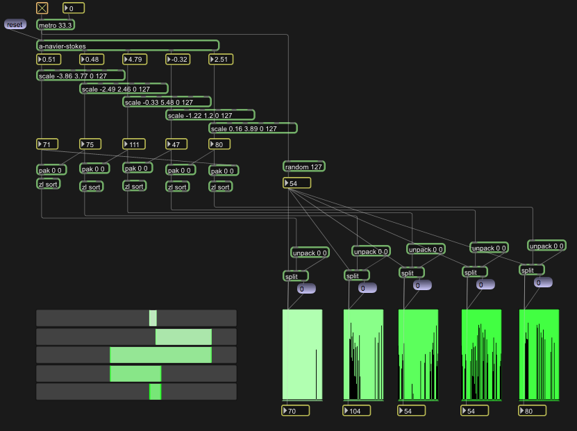
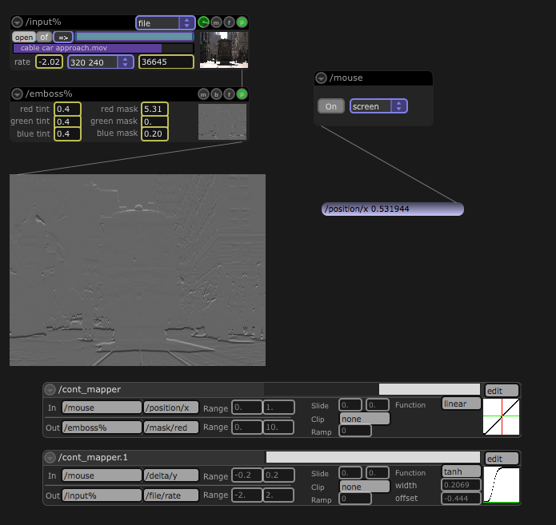

So here I was, faced with the challenge of introducing [Max](http://shop.electrotap.com/products/max-msp-jitter) to an insanely diverse group of painters, sculptors, ceramics majors, and others – some of whom used Max and some of whom had never even heard of it.  Last week I gave a pair of guest presentations at the [Kansas City Art Institute](http://kcai.edu/) (KCAI) to students of a class in the Interdisciplinary Arts department.  KCAI is currently teaching two sections of a course that introduces students of all disciplines to electronics, sensors, basic robotics, microcontrollers, debugging systems, etc.  (As a sidenote, I was honored to teach the inaugural semester of the course a few years ago with [Leigh Rosser](http://colosser.com/), and now the course is taught by [Colin Leipelt](http://www.vimeo.com/colinleipelt)).

A ring from the original Expo '74. Photo: Ian Broyles.

The previous week I was in attendance during a panel session about introducing and teaching Max at [Expo ’74](/74objects/2009/04/27/from-the-expo.html) in San Francisco.  There are all sorts of contexts in which Max is taught: art schools, music conservatories, science laboratories, and even architecture departments.  Some have students with an assumed level of competence or exposure to related topics; others don’t.  There was a lot of discussion about how people deal with the challenges of teaching such diverse people about a tool that may be used in so many radically different ways.

There were also a lot of people trying to squeeze in their thoughts during the session, so I simply observed and took notes.  I do have some thoughts about introducing and teaching Max though.  And then we can answer the question I posed at the open: *How in the world do you introduce Max to a diverse audience with all different quantities and qualities of experience and with whom you have no prior relationship or knowledge?*

## Driving a Car

When I first began studying computer music with [Ichiro Fujinaga](http://www.music.mcgill.ca/~ich/) (then in Baltimore) he liked to use the example of driving a car.  You don’t have know very much about how the car works in order to drive around town.  But if you want to be a really good driver, to maximize fuel use or to race other drivers for example, then you need to understand engines and transmissions and gear ratios.  The point of the analogy is that if we want to really be in control of our computer music systems then we need to understand the concepts and details of what happens under the hood.

I agree with this analogy in the context of my work with Ich.  I think, however, people take this same approach to teaching Max.  And that is often a mistake.

Many (I would argue the vast majority of) users are encountering an entirely foreign construct.  It is completely overwhelming.  In this scenario, the key to teaching Max is the same as when you *first* learn to drive.  That is to say you don’t sweat details.  In the U.S. you probably don’t even start learning to drive on a manual transmission, so you don’t *start* *learning* to press the gas while popping the clutch, let alone memorizing the gear ratios and figuring out how horsepower and torque are related.  If someone tries to think about all these details and parts when trying to get used to the basic act of driving, they are going to wreck the car and may never drive again due to the trauma.

So my first key to teaching Max is this: ***It’s okay hide information or gloss over details – in fact, it’s essential to do so. **To use a bicycling analogy, you can take the training wheels off later.*

One of the ways I do this in a practical way is by presenting a number of things next to each other and indicate that they are all essentially functioning on the same principles – even if what happens underneath the surface is different.  This has been extremely effective.  I had actually forgotten that I formalized a bit of this until I had a conversation with [Richard Boulanger](http://www.berklee.edu/faculty/detail/richard-boulanger) about it at Expo ’74 when he was commenting on some of my older materials from teaching Max which were online.

Another way I do it is by not answering questions asked by students.  Rather than overwhelming a whole class, I simply say that we will cover it later, or it isn’t important right now, or to ask me after class is over.  I don’t always do this, but sometimes the risk of explaining a complex subject or an exception to the rules that you are in the middle of trying to re-inforce, outweighs the benefits.  You can always come back to it later.

## From the Expo Floor

Mousetrap! Photo: Valerie Reneé

There were a couple of ideas during the Expo ’74 panel session that I thought were interesting.  The first was from [Gregory Taylor](http://rtqe.net/), who mentioned using the [Mousetrap](http://en.wikipedia.org/wiki/Mouse_Trap_(board_game)) game to show the sequence of causality.

For teaching a full course, as opposed to a one-off lecture, there was an idea suggested (sadly, I don’t remember who it was) to give assignments to create a patcher that performs a 10 second piece that visually says hello on the monitor.  The next assignment is to hook up a game controller with the hi object, and use that to control the patch.  ”Now every student has an instrument and an installation”.

A notion expressed under several guises is that a good teacher/course will teach concepts rather than tools.  For example, teach basic problem solving  or debugging using the scientific method.  I completely agree, but I like to carry it a step further.  When a student has a problem we solve it together as a class — on the whiteboard with dry-erase markers.  The white board is a great:

- it gets you away from the potential clumsiness of the mouse, keyboard, etc. and worrying about typing the correct thing.
- it gets you away from the monitor and the light beaming into (and frying) your brain (in an emotional sense more than physical)
- it  is comfortable for the whole class to see and contribute
- there is no penalty for meta-patching (that is to say, creating a flow of objects that don’t really exists but represent some kind of concept)

The first couple of points may seem trivial, but they end up being important.  Students get nervous showing their problem in front of the whole class.  There is also a tendency when sitting in front the keyboard/mouse/monitor to *do*.  But solving problems is more about *thinking* before you do, and it is hard to slow down and do that when the machinery is under your finger-tips.  Solving problems requires a return from emotional patching to rational, reasoned, reflection.  So for me, **the whiteboard is king**.

Finally, something I never heard during the panel session, and which surprises me considerably, is that no one mentioned including a history/literature component to their courses teaching Max.  When I’ve taught full-semester courses on Max, I’ve generally split the time evenly between lecturing, tutoring/answering questions, and a history/literature section.  The History and Lit is absolutely crucial to giving students ideas on how to put “the meaningless numbers” to work.

Early in the course I use Risset’s *Duets** for One Pianist* with scores and Max patches to show how, in some cases, simple relationships can yield extremely complex counterpoint.  Every week we have time allocated not only to see/hear/experience literature (music, installation footage, video works, etc) created using Max, but we have time to discuss the work and its artistic merits.  This grounds the course in something tangible, and starts the process of examining how one’s own aesthetics are challenged or expanded by this technology.  ***Part of understanding what you can do with Max is not just understanding the tool, but understanding the paradigms and contexts in which it is used. **My experience is that without this, most artists and musicians will be lost and probably never return to Max after the semester is completed.*

## System Topography

Trying to understand Max is really a subset of another, more general, problem: understanding interactive systems (or any system for that matter).  I first saw this strategy put into action by [Butch Rovan](http://www.soundidea.org/) a number of years ago, during a visit to the University of North Texas (where he was then located). This is the approach I have found most effective when I’m confronted with an audience amongst whom I can assume little commonality of experience.  My sessions at KCAI last week were such a situation.

It goes like this: There 3 primary layers to any interactive system.

- Data Source Layer (analysis results, sensor data, generative algorithms, etc.)
- Mapping Layer

one-to-one relationships
- one-to-many relationships
- many-to-many relationships

- Synthesis Layer (synthesis algorithms, effects processors, spatialization modules, etc.)

I begin by presenting this and offering a little overview of each layer.  The middle layer is really hard, and it’s where most artists working with machines spend their lives.  The outer layers are a bit more objective, and so we begin by looking at those.

### The Data Source Layer

For last week’s foray into Max,  I began with a Max patcher that was shared by Gregory Taylor at last week’s Expo ’74.  In fact, I had it running before anyone even arrived and let it serve as my backdrop for the intro.  It was my hook.  Not only is the patcher really beautiful to watch as the motion ebbs and flows, but it is generating really useful data and demonstrates all of the basic principles of a Max patcher.

After showing Gregory’s patcher, and using it to explain the basics of how Max objects are connected (and how they do their work), I then shifted to talking about sensor inputs.  The class is using the Arduino and is actively working with sensors, so this where they could really start making connections between what they saw Max doing and the projects on which they are already working.

The Art Institute happens to also own a [Teabox](http://shop.electrotap.com/products/teabox) and bunch of sensors from Electrotap (used in their Max course taught by [Dwight Frizzell](http://www.dwightfrizzell.com/)).  So I explained some of the pros and cons of a Teabox vs. the Arduino.  They can do some of the same things, but ultimately the Teabox is easier to use and the Arduino is more flexible – take your pick.  It also gave me a chance to relay my various horror stories of problems in installations caused by relying on devices connected via USB, and thus the decision to have the Teabox connect using a more robust transport mechanism.

### The Synthesis Layer

Time was very limited (I had only 1 hour), and so I didn’t discuss algorithms or technical details for synthesizing audio or video.  Instead, I used a couple of modules from [Jamoma](http://jamoma.org/).  This allowed me to drop in pre-built black-boxes that did something easily grasped without any work at all.  I explained that Jamoma modules are really just Max patches, and that you drop them in connect them together.  In 30 seconds I was able to build a patcher that accepted a wide range of video sources (including files), a cheesy embossing effect, and a video output.

### The Mapping Layer

Then we come back and talk about mapping.  It’s pretty superficial in this context, but I show how mappings can be set up using Jamoma in Max.  First we create a mouse input module to represent our input layer, then we create one or more “continuous mapper” modules to do the mappings, and then start changing those mappings on the fly.  It’s really that easy, and everyone was able to grasp what I was talking about immediately when they saw the mouse position controlling the playback rate of a movie and the embossing of that movie.  And it was another bit of patching that only took about 30 seconds.

## Building on the Work of Others

I like to end by showing some resources and telling them its okay to build on the work of others.  In fact, my opinion is that it is foolish to not build upon the work of others.

One interesting thing I’ve noticed a lot in the last few weeks is how shocked people are that Jamoma is free.  I can say ‘open source’ but it never registers.  I can get to the end of showing Jamoma (at KCAI or Expo ’74, for example) and say you can go download it for *free* and people are shocked and amazed.  It’s nice feeling like something is so obviously useful and well received that people would expect to pay for it.  The whole Jamoma team has something of which to be proud!

It can be difficult to gauge the success of presenting Max, especially in single-session scenarios. The nice thing about longer courses (such as a full semester) is that you can take the time to really establish some confidence in students that they are able to make something work.  I didn’t have that luxury.   An ending question/answer session, or conversations after-the-fact, can give some sense of whether the message was received or if people have been opened up to some new possibilities.

I think presenting Max this way, as I learned from Butch Rovan, really does do this for people regardless of their presuppositions and experience.  I was grateful for the opportunity to present and dialog with group at the Kansas City Art Institute last week, and give them my many thanks.
