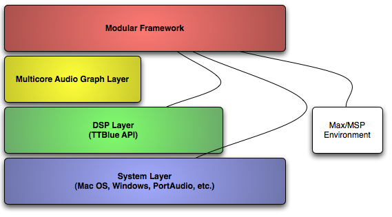
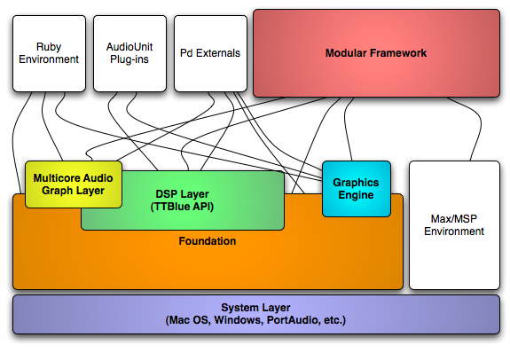

*Over the last several months I haven’t been writing much in the way of prose.  Instead I have been working on the Jamoma 0.5 release, a consulting project built on top of the Jamoma DSP layer, and developing a graphics library to support a new version of Hipno.  Now, at the end of these projects we are doing much more than just dsp with the Jamoma “DSP” layer – in fact Jamoma underwent a major refactoring and restructuring.*

## The Jamoma Platform Revisited

In my previous post about [The Jamoma Platform](/web/20130707051924/http://74objects.com/2009/04/15/the-jamoma-platform/), we introduced a graphic that looked like this first graphic.  The DSP Layer had a lot going on.  It was a runtime for a dynamically-bound object-oriented framework.  It was starting to grow graphics capabilities.  And Ruby language bindings.  None of this stuff has anything to do with audio or digital signal processing.

So it was time to break apart the monolithic beast to make the structure clearer, more focused, more flexible and to increase orthogonality and decoupling.

## A New Pile

The layers are now piled up on top of the **Jamoma Foundation**.  The Foundation is analogous to Cocoa’s Foundation classes.  It defines and implements the basic runtime architecture on which everything else relies.  It includes the base classes, message passing system, notifications, OS-specific glue, object instantiation, etc.

The **DSP Layer**, now, is actually focused on audio and signal processing.  It extends the Foundation’s classes to make it easy to create dynamically bound audio objects.  As before, there are example projects in Jamoma that compile into PureData externals and VST/AudioUnit plug-ins, but I’ve now taken the care to add them to the graphic.

The **Multicore Audio Graph Layer** is largely unchanged, as it was already separated from the DSP Layer.  With the new extensions, such as the Ruby language bindings, it becomes possible to create a graph of audio objects in real time using Ruby’s irb somewhat in the fashion that people use Ge Wang’s excellent Chuck environment.

Meanwhile, the new **Graphics Engine** creates both a platform-independent, and a host-independent, way to draw to the screen.  This means that GUI widgets can be created that will work both in Max/MSP and in other environments, such as AudioUnit plug-ins.  Internally the drawing is performed using the Cairo graphics library.  We extend the library to deal with other OS-related issues like fonts, mouse interaction, creating windows, etc.  We also make the Cairo API available through the Foundation’s message-passing system in addition to the old-fashioned static linking.  That means that we can perform drawing dynamically from environments such as Ruby.

## Making it Happen

As an open source project, it is quite impressive how much a smallish group has been able to accomplish with limited resources and man-power.  While we may have missed on a few things, we have definitely gotten a lot of “bang for the buck”.  I mention this because we could use some help.  There are lots of areas where contributions are welcome.  We have a particular need for someone who is handy with C++ and oriented towards the Windows platform.  If you are interested, please make yourself known to us.  We don’t bite  .

Information can be found at the [Jamoma](http://jamoma.org/) website and over at [our Github repository](http://github.com/tap/Jamoma).
