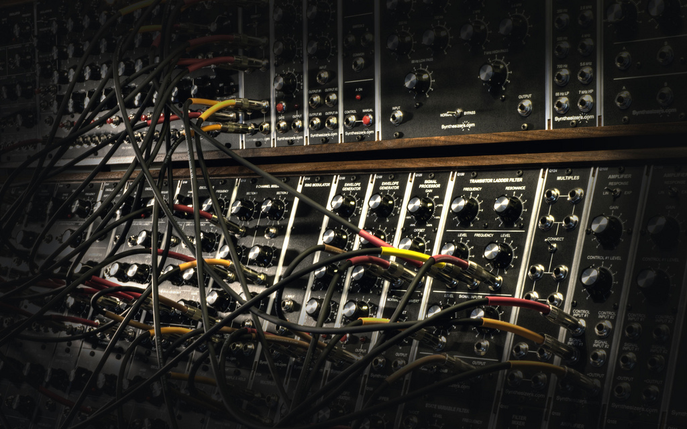
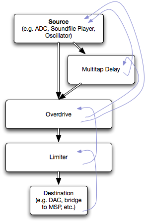

In previous articles about [the Jamoma Platform](/74objects/2009/12/01/refactoring-jamoma.html) and the [Jamoma DSP Library](/74objects/2009/12/03/writing-dsp-objects.html), there have been references to [Jamoma Audio Graph](http://redmine.jamoma.org/projects/show/multicore) (also previously known as *Jamoma Multicore*).  Up to this point, Jamoma Audio Graph has not been significantly documented or written about.  The authoritative information has been [an Electrotap blog post](http://www.electrotap.com/blog/489) showing the initial prototype in 2008.
At [a workshop in Albi](http://groupware.bek.no/groups/jamoma/wiki/061e0/Jamoma_spatialization_workshop_at_GMEA_in_Albi_2009.html) in 2009 we attempted to further expand Jamoma Audio Graph — and we failed.  The architecture was not able to handle N multichannel inputs and M multichannel outputs.  So we had to redesign a major portion of the inner-workings.  Get out your pipe wrench; it’s time to take a look at some plumbing…

## What Is Jamoma Audio Graph ?

Let’s back up for moment to get the big picture.  [The Jamoma Platform](/74objects/2009/12/01/refactoring-jamoma.html) is essentially a layered architecture implementing various processes for interactive art, research, music, etc.  At the lowest level, the **Jamoma Foundation** delivers basic components for creating objects, passing values, storing values in lookup-tables, etc.  The **Jamoma DSP** library then extends the Foundation classes and provides a set of pre-built objects for audio signal processing.

**Jamoma Audio Graph** then gives us the ability to create Jamoma DSP objects and combine them into a [graph](http://en.wikipedia.org/wiki/Graph_(data_structure)).  In other words, we can connect the objects together like you might connect modules together on a Moog synthesizer.

[](http://www.flickr.com/photos/petergorges/2681345079/)A Moog Modular Patch. Photo: Maschinenraum

Unlike the Moog synthesizers of old, however, we can do a few new tricks.  Instead of sending a single channel of audio through a connection, we can send any number of channels through a connection.  While Jamoma Audio Graph does not currently implement any particular features for parellel processing on multiple cores/processors, the design of the system is ideal for such parallelization in the future.

## The Audio Graph In Action

At the time of this writing, Jamoma Audio Graph has bridges to make it available in the [Max](http://puredata.info/) and [Ruby](http://www.ruby-lang.org/en/about/) environments.  Most of the work is done on making it available to [Pd](http://puredata.info/) as well (though if you are really interested in this then [let us know](http://jamoma.org/forums.html) so we can put you to work!).

In Ruby, you can code scripts that are executed in a sequence.  This provides a static interface to Jamoma Audio Graph even though all of the synthesis and processing is typically happening in real-time.  Alternatively, the **irb** environment allows you to type and execute commands interactively.  Jamoma Audio Graph, together with irb, then functions much like the [ChucK](http://chuck.cs.princeton.edu/) environment for live coding performance.

### Example

If you’ve been jonesin’ for an Atari/Amiga/Commodore fix then this might be your perfect example of Jamoma Audio Graph in Ruby:

```
# This is the standard require for the Jamoma Platform's Ruby bindings
require 'TTRuby'

# Create a couple of objects:
dac = TTAudio.new "multicore.output"
osc = TTAudio.new "wavetable"

# connect the oscillator to the dac
dac.connect_audio osc

# turn on the dac
dac.send "start"

# play a little tune...
osc.set "frequency", 220.0
sleep 1.0
osc.set "frequency", 440.0
sleep 1.0
osc.set "frequency", 330.0
sleep 0.5
osc.set "frequency", 220.0
sleep 2.0

# all done
dac.send "stop"
```

It’s a pretty cheesy example, but it should give you a quick taste.  If you want a flashback to kinds of music you could make with MS-DOS, be sure you set the oscillator to use a square waveform.

After creating a couple of objects, you connect two objects by passing the source object to the destination object using a **connect** message.  If you provide no further arguments, then the connection is made between the first **outlet** of the source object and first **inlet** of the destination object.  The inlets and outlets are numbered from zero, so the connect message in our example could also have been written as

```
dac.connect osc, 0, 0
```

The **sleep** commands are standard Ruby.  They tell Ruby to pause execution for the specified number of seconds.  Everything else is performed with the basic Jamoma Ruby bindings.  These provide the **send** method for sending messages and the **set** method for setting attribute values.

If you want to know the messages or attributes that an object possesses, you can use the **messages?** or **attributes?** methods.  This is particularly useful when coding on the fly in irb.  In the following example, I requested the list of attributes for the oscillator in the previous example:

```
>> osc.attributes?
=> ["gain", "mode", "size", "processInPlace", "maxNumChannels", "frequency", "mute", "interpolation", "sr", "bypass"]
```

## How It Operates

If you create a visual data-flow diagram of the objects in a graph, like you would see in Max or PureData, then you would get a good sense of how audio starts at the top and works its way through various filters until it gets to the bottom.  The same is true for a Jamoma Audio Graph.  However, what is happening under the surface is exactly the opposite.

### Pull I/O Model

[](/assets/images/74objects/2010-02-multicore.png)The flow of a Jamoma Audio Graph.

Jamoma Audio Graph is based on a “Pull” I/O Model.  Some other examples of audio graph solutions using a similar model include ChucK and [Apple’s AUGraph](http://developer.apple.com/mac/library/documentation/AudioToolbox/Reference/AUGraphServicesReference/Reference/reference.html).  In this model a destination, sink, or terminal node object sits at the bottom of any given graph — and this is the object driving the whole operation.  In Max, on the other hand, messages (e.g. a ‘bang’ from a metro) begins at the top of the graph and *pushes* down through the objects in the chain.

The image to the left visualizes the operation of the audio graph.  Let’s assume the the destination object is an interface to your computer’s DAC.  The DAC will request blocks of samples (vectors) every so often as it needs them.  To keep it simple, we’ll say that we are processing samples at a sample rate of 44.1KHz and a block size of 512 samples.  In this case, every 11 milliseconds the DAC will tell our destination object that it needs a block of samples and the process begins.

The process flows through the light blue lines.  The destination asks the limiter for a block of samples, which then asks the overdrive for a block of samples which then asks both the source and the multitap delay for samples, and then the multitap delays asks the source for a block of samples.  To summarize it: each object receives a request for a block of samples, and in response it needs to produce that block of sample values, possibly pulling blocks of samples from additional objects in the process.

### One Object At A Time

To understand in finer detail what happens in each object, the graphic below zooms-in to view a single instance in the graphic above.  Here we can see that we have the actual unit generator, which is a Jamoma DSP object, and then a host of other objects that work to make the interface for the audio graph.

[](/assets/images/74objects/2010-01-anatomy.png)Jamoma Audio Graph class structure

The text in graphic explains each of the classes contained in a Jamoma Audio Graph object.  Implied in both of the figures, is the ability to handle “fanning” connections where many inlets are connected to an outlet, or an inlet is connected to many outlets.

In essence, the outlets are only buffers storing samples produced by the unit generator.  Each time a block is processed the unit generator is invoked only once.  Subsequent requests for the object’s samples then simply access the samples already stored in the outlet buffers.

As explained in the graphic, the inlets have more work to do, as they need to sum the signals that are connected.  And remember, each connection can have zero or more channels!

## Benefits

The most obvious  benefit is the ability to easily handle multiple channels in a single connection.  So imagine that you create a Max patcher for mono operation.  It can then function in stereo or 8-channel or 32-channel without a single modification.

But there’s a lot more than that here.  The number of channels is dynamic and can change at any time.  One place this is valuable is in ambisonic encoding and decoding where the order of the encoding can dramatically alter the number of channels required for the encoded signal.  If you want to try changing the ambisonic order on-the-fly, which changes the number of channels passed, you can.

Likewise, the vectorsize can be altered dynamically on a per-signal basis.  The benefit here may not be immediately obvious, but for granular synthesis, spectral work, and analysis based on the wave length of an audio signal (e.g. the kinds of things in [IRCAM’s Gabor](http://ftm.ircam.fr/index.php/Gabor)) this can be a huge win.

Writing the objects is also very simple.  If you [write a Jamoma DSP object](/74objects/2009/12/03/writing-dsp-objects.html), then all you have to do to make it available in Jamoma Audio Graph is…

*Nothing!*

That’s right.  In Ruby, for example, all Jamoma DSP classes are made available with no extra work.  If you want to make a Max external for a particular object then you can use a class wrapper (1 line of code) to create the Max external.

Interested in join the fun?  [Come find us](http://redmine.jamoma.org/)!
