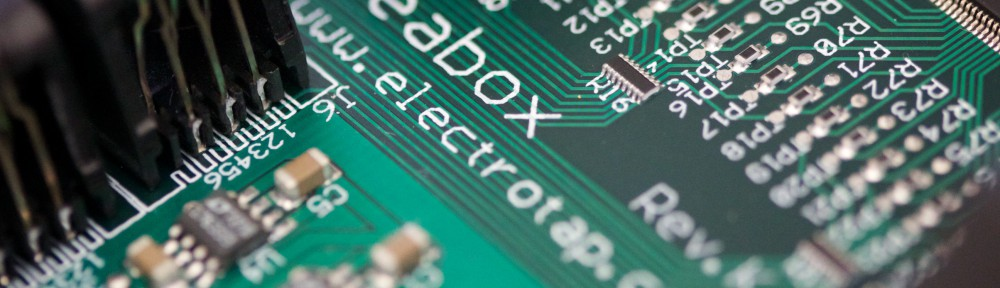

I met [Jeff Albert](http://jeffalbert.com/) three years ago through Louisiana State University’s Experimental Music and Digital Media program. He was introduced as an established performing and recording trombonist who curates a new music night, Open Ears Music Series, in the ‘real part’ of the New Orleans French Quarter. He is in fact much more that. Jeff was named a Rising Star Trombonist in the 2011 Downbeat Critics Poll, has performed with Stevie Wonder, Bonnie Raitt, The Funk Brothers, Wardell Quezergue, Dr. John, among others, teaches Music Technology at Loyola University New Orleans, all the while is finishing his PhD at LSU. I chatted with Jeff to talk shop and more.

**What to do you do?**

I like to make music, with trombones and computers being my main tools. I do some mixing and mastering work on CDs, mostly in the free jazz/improvised music space. I also teach music technology classes at Loyola University New Orleans, and organize the Open Ears Music Series in New Orleans. I am the transportation manager for my family, making sure that everyone gets to piano/ballet/soccer/softball, etc. I also do our family IT stuff. I coach U12 Girls soccer, and excel at embarrassing my children.

**I know you are involved with different musicians and groups. How do they differ? Do they fulfill a need or exist as an outlet in any way? Are there any differing musical or mental processes – like when working with [Pretty Lights](http://prettylightsmusic.com/) to Hamid Drake? **

I guess I would say that everything I do fulfills a need or is an outlet of some sort. Even the very commercial trombone playing I do fulfills a need for time on the instrument, and is a social outlet. Lately I have been subbing in Lena Prima’s band in the French Quarter. She is Louis Prima’s daughter, and does some of his music, as well as other stuff. That gig isn’t really an artistic outlet for me, but it is a lot of fun, and that counts for something too.

The Pretty Lights stuff was just a few studio sessions. I am really curious about how that material will end up sounding in its final form, because he just recorded lots of bits and pieces of the musicians playing (based on his directions), and is gong to reassemble it in his style. The sessions were cool, but I think the real magic in that music will happen when he samples and reassembles what we recorded.

My work with Hamid Drake has been mostly in his group Bindu Reggaeology, which is basically a reggae band made up of some of the world’s best improvisers. I wish we could work more often with that band.

My own groups do exist as outlets. Usually outlets for personal expression in unedited form. So much of my early career was spent striving to fill a specific predefined role in a group (i.e. when playing with the Tommy Dorsey Orch, striving to really play “that style” well), that I use my groups as the place where I get to make music the way I want to hear it, as opposed to the way I think someone else expects it to be.

**Has curating [Open Ears Music](http://openearsmusic.org/) affected your own music? How?**

Mostly by exposing me to lots of good music. Every week I hear at least one live performance, and most of them are very good. That gets my creative juices flowing. It is inspiring.

Watching how so much different music is received by the audiences has also been enlightening, although I might be hard pressed to describe exactly what I have learned from that. I guess on the most basic level, I have learned that people react to *really good* music regardless of style.

**What have you listened to recently that left an impression on you?**
Just today I listened to some unreleased live recordings of the Louisiana Philharmonic Orchestra, and I was struck by how good they sounded. New Orleans has the best orchestra in its price range by a long way. A couple of weeks ago, I was on a Crosby, Stills & Nash kick. I like cool harmony singing. I have been checking out the new CD from Mike Reed’s People Places & Things, and the Henry Threadgill box set of Black Saint/Soul Note recordings. Some recent “work” listening has included Jon Appleton & Don Cherry’s “Human Music” and George Lewis’s “Voyager.” Everything that I listen to makes some sort of impression on me. I wish I had more time to wander about the internet with no apparent goal, just looking for new stuff to hear, but it seems like these days, most of what I decide to listen to is music that I already know something about, or that I listen to for some research related reason.

I also listen to lots of RadioLab podcasts in the car.

**How has your music changed for 5 years ago? 10 years ago?**

10 years ago, I was just adding a personal artistic aspect to my life as a jobbing, craftsman, professional musician. I had just released a CD with a band called the Albert-Ankrum Project. It was pretty inside the mainstream contemporary jazz.  My jazz output has moved farther left over the years, and my current quartet is musically descendant from Ornette Coleman and others in the jazz influenced free improvisation spaces. I was into freer improvisation styles 10+ years ago, I just wasn’t brave enough to do it with my primary performing group.

I have also added the computer as one of my music making tools in the last 5+ years. 10 years ago I would not have believed that I would do gigs with a computer and no trombone, or that I would design the instruments I’d play on those gigs, or that I would be into composing electronic music for fixed media. Those are all things that have found their way into my musical life fairly recently, and I have found that they are a great aesthetic compliment to my other pursuits. I think my acoustic work and electronic work each inform the other in significant ways.

**What is one cool thing you’ve recently added to your ‘bag of tricks’ (gear, technique, one of those things Jeff does)? **

I feel that my bag of tricks has been a bit stagnant lately. I’m on the search for that next cool thing.

**What’s one cool thing that you wish you could add  that would make your music-making one notch higher?**

I would love to be able to put together an “integrated Jeff” rig that would allow me to do acoustic trombone, processed trombone, and laptop-as-instrument all from one set up. I am going to start working on that when ever I finish my dissertation.

**You describe your music in “spaces”, and label a few trombone, acoustic, and electronic. And they “inform” each other. I want to get a commonality out of all of them. What makes them all ‘Jeff Albert’?**

Hopefully they are all interesting, honest, and at least a little bit funny at times.

–>