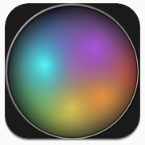
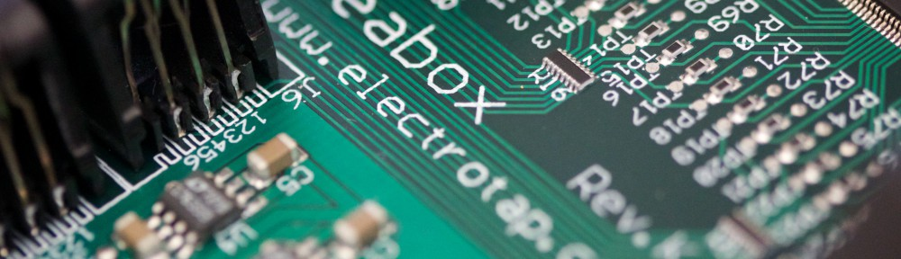

Every year we make New Year’s resolutions. This year Jesse Allison and I sat down and took a good long look at Electrotap. The world has changed a lot since we started Electrotap, but we still believe in what we’re doing, that it’s important for many artists that we care about, and that we want Electrotap to thrive. We also had to admit that we had some work to do to address a number of concerns. We needed to reboot the machine.

So what have we accomplished so far in 2012?

- Launch of the 4 new Hemisphere models with[ Stephan Moore](http://oddnoise.com/) of [Isobel Audio](http://isobelaudio.com/)
- Introduce the new [HipnoTouch](http://www.electrotap.com/hipnotouch) app for the iPhone/iPod, with versions forthcoming for the iPad and Android.
- Updated [Tap.Tools](http://shop.electrotap.com/products/taptools) for Max 6
- We now sell [Max 6](http://shop.electrotap.com/products/max-msp-jitter) on our site, bundled with Tap.Tools, to offer a fabulous price (up to **$199 discount**).
- Released the source for one of the original Hipno plug-ins ([Multilution](http://www.electrotap.com/downloads/)) with plans to bring back a number of the original Hipno plug-ins in the future
- Introduced the [Naked Teabox](http://shop.electrotap.com/products/naked-teabox)
- Reduced the price of the classic [Teabox](http://shop.electrotap.com/products/teabox) **by $100**
- We have [Electrotap T-Shirts](http://shop.electrotap.com/products/electrotap-t-shirt) now!
- We’ve made some dramatic improvements to our support system for handling inquiries.  We are now able to get metrics to evaluate how we are doing, and we have numbers showing that we have dramatically improved.
- We’ve overhauled our website.
- We have a new [Electrotap channel on you tube](http://www.youtube.com/ElectrotapChannel) and we’ve started producing video content about or products.
- We are now soliciting projects and interviews from artists to feature on our site.  To kick things off, we’ve [interviewed Jeff Albert](/electrotap/2012/07/21/interview-with-jeff-albert.html).
- We’ve renewed our commitment to [Jamoma](http://jamoma.org/) by providing both source code / man-hours and also making a financial donation
- We’ve sponsored two conferences: [SLEO](http://sleo2012.cct.lsu.edu/) and [NIME](http://www.eecs.umich.edu/nime2012/)

So, as you can see, we’ve been busy!  ***During one stretch this past Spring we did 5 product announcements in 5 days.***

                    

## Let’s Celebrate

To celebrate, we are going to offer an additional discount on new registrations of [Tap.Tools](http://shop.electrotap.com/products/taptools) for the next month. Use the discount code **R3BOOT** on checkout and get **$30 off** the order.

## What’s Next?

First, [you should buy the discounted Max now](http://shop.electrotap.com/products/max-msp-jitter). There is no guarantee that we will keep it at this price.

Second, stay tuned. Whether by [Twitter](https://twitter.com/@electrotap) or [Facebook](http://facebook.com/electrotap), we have a bunch of things in the pipe for the next few months and years.

We’re excited to have another new app for iOS in preparation for the AppStore.

We also have a new product that has been much requested over the last several years and which we’ll be rolling out in the next couple of months. It’s a surprise though, so don’t tell anyone ;-).